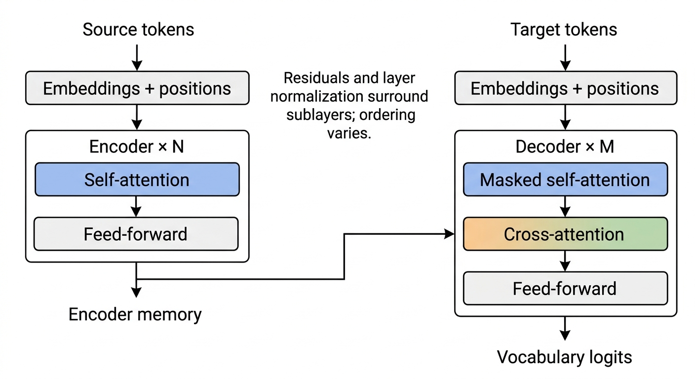
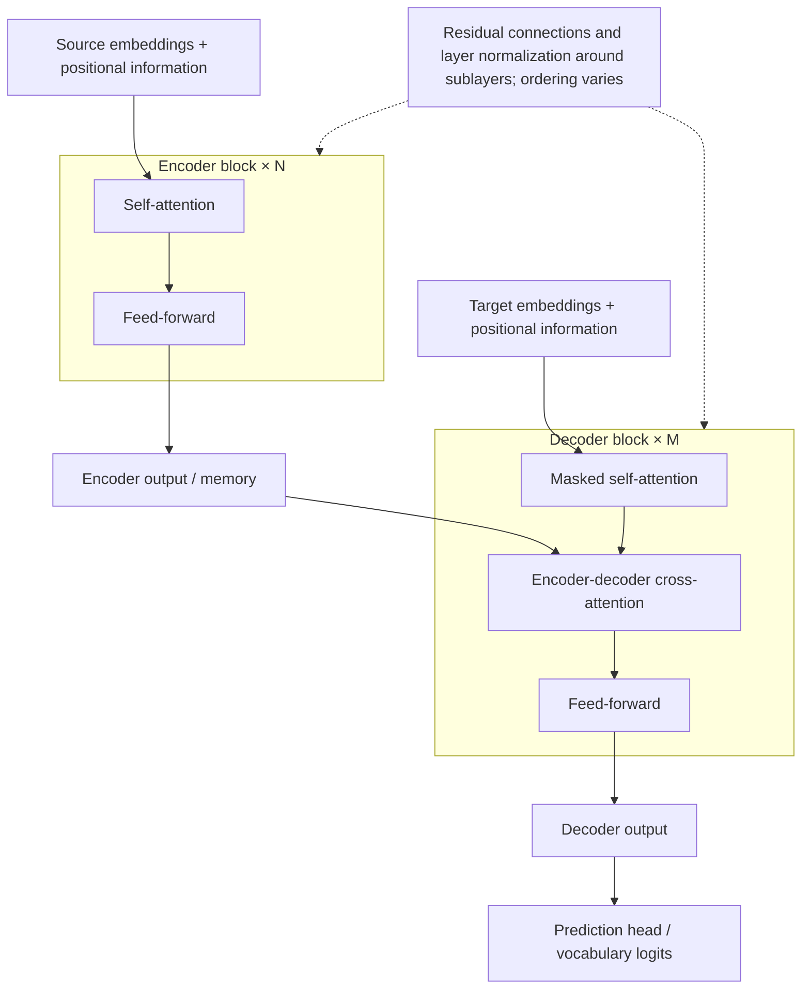
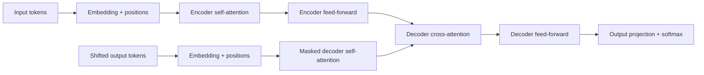

# Self-Attention in Transformer Architecture

## Orient the reader with a Transformer architecture image

The diagram shows where self-attention sits in an encoder-decoder Transformer. The source sequence enters the encoder as token embeddings combined with positional information. Each encoder block uses self-attention to mix information across source positions, followed by a feed-forward layer.


*Self-attention operates within the encoder and decoder, while decoder cross-attention accesses encoder memory.*



The decoder also receives target embeddings and positional information. Its **masked self-attention** prevents a position from attending to future target positions. Cross-attention then lets decoder positions attend to the encoder’s output; a feed-forward layer follows.

Residual connections and layer normalization surround the sublayers. Their exact ordering varies across Transformer designs, so the diagram does not prescribe one.

For batch size `B`, source length `S`, target length `T`, and model width `d`, the encoder produces memory shaped `(B, S, d)`. Cross-attention uses that memory while producing decoder representations shaped `(B, T, d)`. The prediction head maps those representations to vocabulary logits shaped `(B, T, V)`, where `V` is the vocabulary size.

## Build the intuition for self-attention

Consider: “She sat by the river bank.” The token **bank** could refer to a financial institution or a riverbank. Self-attention lets its representation incorporate information from **river**, making the context available to later layers.

The diagram shows a Transformer encoder. Each layer updates every token representation using self-attention and a feed-forward network.

<svg xmlns="http://www.w3.org/2000/svg" viewBox="0 0 500 370" width="500" role="img" aria-label="Transformer encoder architecture: input tokens flow through embeddings and positional information, self-attention, normalization, a feed-forward network, and normalization to produce contextual representations. Residual connections bypass the attention and feed-forward blocks.">
  <defs>
    <marker id="arrow" viewBox="0 0 10 10" refX="9" refY="5" markerWidth="6" markerHeight="6" orient="auto">
      <path d="M 0 0 L 10 5 L 0 10 z" fill="#333"/>
    </marker>
  </defs>
  <g fill="#eef4fb" stroke="#345" stroke-width="1.5">
    <rect x="125" y="10" width="250" height="30" rx="4"/>
    <rect x="125" y="60" width="250" height="30" rx="4"/>
    <rect x="125" y="110" width="250" height="30" rx="4"/>
    <rect x="125" y="160" width="250" height="30" rx="4"/>
    <rect x="125" y="210" width="250" height="30" rx="4"/>
    <rect x="125" y="260" width="250" height="30" rx="4"/>
    <rect x="125" y="310" width="250" height="30" rx="4"/>
  </g>
  <g font-family="sans-serif" font-size="14" text-anchor="middle" fill="#111">
    <text x="250" y="30">Input tokens</text>
    <text x="250" y="80">Embeddings + positions</text>
    <text x="250" y="130">Multi-head self-attention</text>
    <text x="250" y="180">Add + normalize</text>
    <text x="250" y="230">Feed-forward network</text>
    <text x="250" y="280">Add + normalize</text>
    <text x="250" y="330">Contextual representations</text>
  </g>
  <g fill="none" stroke="#333" stroke-width="1.5" marker-end="url(#arrow)">
    <path d="M250 40 V60 M250 90 V110 M250 140 V160 M250 190 V210 M250 240 V260 M250 290 V310"/>
    <path d="M250 100 H85 V175 H125"/>
    <path d="M250 200 H65 V275 H125"/>
  </g>
  <text x="15" y="150" font-family="sans-serif" font-size="12">Residuals</text>
</svg>

For one attention head, let the input be \(X\in\mathbb{R}^{n\times d}\), with \(n\) tokens and width \(d\). Learned projections produce queries \(Q\), keys \(K\), and values \(V\), each of shape \(n\times d\). A query asks what a token should look for; keys determine which tokens match; values supply the information to combine. Each output is a weighted sum of the values.

In **self-attention**, \(Q\), \(K\), and \(V\) all come from the same input \(X\). In **cross-attention**, queries come from one sequence, while keys and values come from another—for example, decoder states attending to encoder outputs.

Attention alone does not encode token order. Positional information is added to token representations so the model can distinguish sequences such as “dog bites man” and “man bites dog.”

## Calculate scaled dot-product attention

For one attention head, let the input be \(X \in \mathbb{R}^{B \times N \times d_{\text{model}}}\), where \(B\) is the batch size and \(N\) is the sequence length. Three learned projections produce queries, keys, and values:

- \(W_Q, W_K \in \mathbb{R}^{d_{\text{model}} \times d_k}\)
- \(W_V \in \mathbb{R}^{d_{\text{model}} \times d_v}\)
- \(Q=XW_Q\) and \(K=XW_K\), each shaped \(B \times N \times d_k\)
- \(V=XW_V\), shaped \(B \times N \times d_v\)

The diagram places attention inside a Transformer’s encoder and decoder:

<svg xmlns="http://www.w3.org/2000/svg" width="600" height="310" viewBox="0 0 600 310" role="img" aria-label="Transformer architecture showing encoder self-attention and decoder masked self-attention and cross-attention">
  <defs>
    <marker id="arrow" viewBox="0 0 10 10" refX="9" refY="5" markerWidth="6" markerHeight="6" orient="auto">
      <path d="M 0 0 L 10 5 L 0 10 z" fill="#333"/>
    </marker>
  </defs>
  <g font-family="sans-serif" font-size="13" text-anchor="middle" fill="#111">
    <text x="145" y="18" font-weight="bold">Encoder</text>
    <text x="455" y="18" font-weight="bold">Decoder</text>
    <g fill="#e8f0fe" stroke="#555">
      <rect x="35" y="30" width="220" height="35" rx="4"/>
      <rect x="35" y="80" width="220" height="35" rx="4"/>
      <rect x="35" y="130" width="220" height="35" rx="4"/>
      <rect x="345" y="30" width="220" height="35" rx="4"/>
      <rect x="345" y="80" width="220" height="35" rx="4"/>
      <rect x="345" y="130" width="220" height="35" rx="4"/>
      <rect x="345" y="180" width="220" height="35" rx="4"/>
      <rect x="345" y="230" width="220" height="35" rx="4"/>
    </g>
    <text x="145" y="52">Input embeddings + positions</text>
    <text x="145" y="102">Self-attention</text>
    <text x="145" y="152">Feed-forward</text>
    <text x="455" y="52">Output embeddings + positions</text>
    <text x="455" y="102">Masked self-attention</text>
    <text x="455" y="152">Cross-attention</text>
    <text x="455" y="202">Feed-forward</text>
    <text x="455" y="252">Output projection</text>
  </g>
  <g stroke="#333" stroke-width="1.5" marker-end="url(#arrow)">
    <line x1="145" y1="65" x2="145" y2="80"/>
    <line x1="145" y1="115" x2="145" y2="130"/>
    <line x1="455" y1="65" x2="455" y2="80"/>
    <line x1="455" y1="115" x2="455" y2="130"/>
    <line x1="455" y1="165" x2="455" y2="180"/>
    <line x1="455" y1="215" x2="455" y2="230"/>
    <line x1="255" y1="147" x2="345" y2="147"/>
  </g>
</svg>

Multiplying \(QK^\mathsf{T}\), with the transpose applied to the last two dimensions, gives scores of shape \(B \times N \times N\). Each row compares one query with every key. Divide by \(\sqrt{d_k}\), then apply softmax across each row:

\[
A=\operatorname{softmax}\left(\frac{QK^\mathsf{T}}{\sqrt{d_k}}\right),
\qquad O=AV
\]

The weights \(A\) have shape \(B \times N \times N\); the output \(O\) has shape \(B \times N \times d_v\). Scaling limits the growth of dot products as \(d_k\) increases, reducing softmax saturation.

For example, take \(B=1\), \(N=2\), \(d_k=d_v=2\), and:

\[
Q=K=V=\begin{bmatrix}1&0\\0&1\end{bmatrix}
\]

The scaled scores are \(\begin{bmatrix}0.707&0\\0&0.707\end{bmatrix}\). Row-wise softmax gives approximately:

\[
A=\begin{bmatrix}0.670&0.330\\0.330&0.670\end{bmatrix}
\]

Because \(V\) is the identity matrix, \(O=AV=A\).

To exclude positions, add a mask to the **scaled scores before softmax**. For causal attention, set the first row’s second entry to \(-\infty\): its weight becomes zero, and that row becomes \([1,0]\). The second row remains \([0.330,0.670]\).

## Extend attention to multiple heads

Multi-head attention learns several attention representations in parallel. Given an input tensor \(X\) of shape \((B, T, d_{\text{model}})\), it applies three learned matrices \(W_Q\), \(W_K\), and \(W_V\) to produce queries, keys, and values. In the standard equal-width setup, each matrix has shape \((d_{\text{model}}, d_{\text{model}})\). For \(h\) heads, choose \(d_{\text{model}}\) divisible by \(h\), so each head has width \(d_h = d_{\text{model}} / h\).

Each projected tensor starts with shape \((B, T, d_{\text{model}})\). Reshape it to \((B, T, h, d_h)\), then transpose it to \((B, h, T, d_h)\). Each head now has its own queries, keys, and values. It computes attention scores across the \(T\) positions and uses those scores to combine its values.

Each head produces an output of shape \((B, T, d_h)\). Concatenating the \(h\) outputs along the feature dimension restores \((B, T, d_{\text{model}})\). A learned output matrix \(W_O\), with shape \((d_{\text{model}}, d_{\text{model}})\), then mixes information across heads.

In a pre-normalized Transformer block, layer normalization precedes the attention sublayer, and a residual connection adds its input back to the projected output. A second normalized sublayer applies a feed-forward network independently at each position, followed by another residual addition.

<svg xmlns="http://www.w3.org/2000/svg" width="640" height="440" viewBox="0 0 640 440" role="img" aria-labelledby="diagram-title">
  <title id="diagram-title">Pre-normalized Transformer block with multi-head attention and a position-wise feed-forward network</title>
  <defs>
    <marker id="arrow" viewBox="0 0 10 10" refX="9" refY="5" markerWidth="6" markerHeight="6" orient="auto-start-reverse">
      <path d="M 0 0 L 10 5 L 0 10 z" fill="#333"/>
    </marker>
  </defs>
  <g fill="none" stroke="#333" stroke-width="2" marker-end="url(#arrow)">
    <path d="M 300 25 V 45"/>
    <path d="M 300 80 V 100"/>
    <path d="M 300 150 V 170"/>
    <path d="M 300 205 V 230"/>
    <path d="M 300 265 V 290"/>
    <path d="M 300 330 V 350"/>
    <path d="M 300 385 V 410"/>
    <path d="M 300 35 H 510 V 187 H 400"/>
    <path d="M 300 216 H 470 V 367 H 400"/>
  </g>
  <g fill="#eef3fa" stroke="#333">
    <rect x="200" y="45" width="200" height="35" rx="4"/>
    <rect x="200" y="100" width="200" height="50" rx="4"/>
    <rect x="200" y="170" width="200" height="35" rx="4"/>
    <rect x="200" y="230" width="200" height="35" rx="4"/>
    <rect x="200" y="290" width="200" height="40" rx="4"/>
    <rect x="200" y="350" width="200" height="35" rx="4"/>
  </g>
  <g font-family="sans-serif" font-size="14" text-anchor="middle" fill="#111">
    <text x="300" y="19">Input X</text>
    <text x="300" y="67">Layer normalization</text>
    <text x="300" y="120">Multi-head attention</text>
    <text x="300" y="139">Q, K, V → heads → W<tspan baseline-shift="sub" font-size="10">O</tspan></text>
    <text x="300" y="192">Residual addition</text>
    <text x="300" y="252">Layer normalization</text>
    <text x="300" y="315">Position-wise feed-forward</text>
    <text x="300" y="372">Residual addition</text>
    <text x="300" y="428">Block output</text>
    <text x="550" y="115">Residual</text>
    <text x="510" y="278">Residual</text>
  </g>
</svg>

## Implement a minimal self-attention example

The diagram places self-attention in a Transformer’s encoder and decoder. This example implements one attention head, not the full architecture.



For clarity, the diagram omits residual connections and layer normalization.

The runnable script below uses three tokens and a model dimension of four. Fixed projection matrices produce queries `Q` and keys `K` with shape `(3, 2)`, and values `V` with shape `(3, 2)`.

Scores are scaled by the square root of the key dimension. Subtracting each row’s maximum before exponentiation makes softmax numerically stable. Multiplying the resulting weights by `V` gives the output.

An optional causal mask sets scores for future positions to negative infinity before softmax. The checks run both masked and unmasked attention, verifying shapes and row sums; the masked run also verifies that future positions have exactly zero weight.

```python
import numpy as np

# 1. Input and fixed projections
X = np.array([[1., 0., 1., 0.],
              [0., 1., 0., 1.],
              [1., 1., 0., 0.]])                 # (3, 4)

Wq = np.array([[1., 0.], [0., 1.],
               [1., 0.], [0., 1.]])              # (4, 2)
Wk = np.array([[0., 1.], [1., 0.],
               [1., 0.], [0., 1.]])              # (4, 2)
Wv = np.array([[1., 0.], [0., 1.],
               [0., 1.], [1., 0.]])              # (4, 2)

Q, K, V = X @ Wq, X @ Wk, X @ Wv               # each (3, 2)

def attention(Q, K, V, causal=False):
    # 2. Scaled scores
    scores = Q @ K.T / np.sqrt(K.shape[1])      # (3, 3)

    # 3. Optionally block future positions
    future = np.triu(np.ones(scores.shape, dtype=bool), k=1)
    if causal:
        scores = np.where(future, -np.inf, scores)

    # Stable softmax and weighted value sum
    exp_scores = np.exp(scores - scores.max(axis=-1, keepdims=True))
    weights = exp_scores / exp_scores.sum(axis=-1, keepdims=True)
    return weights @ V, weights                 # (3, 2), (3, 3)

# 4. Verify both modes
for causal in (False, True):
    output, weights = attention(Q, K, V, causal=causal)
    assert output.shape == (3, 2)
    assert weights.shape == (3, 3)
    np.testing.assert_allclose(weights.sum(axis=1), np.ones(3))

    if causal:
        future = np.triu(np.ones(weights.shape, dtype=bool), k=1)
        np.testing.assert_array_equal(weights[future], 0.0)

    print(f"causal={causal}\nweights:\n{weights}\noutput:\n{output}\n")
```

The output projection, multiple heads, and batching are omitted; this isolates the attention calculation itself.

## Debug masks and reason about cost

<svg xmlns="http://www.w3.org/2000/svg" viewBox="0 0 620 410" role="img" aria-labelledby="diagram-title">
  <title id="diagram-title">Transformer encoder block with masked self-attention and residual connections</title>
  <defs>
    <marker id="arrow" markerWidth="8" markerHeight="8" refX="7" refY="4" orient="auto">
      <path d="M0,0 L8,4 L0,8 Z" fill="#333"/>
    </marker>
  </defs>
  <g fill="#eef4fc" stroke="#333" stroke-width="2">
    <rect x="135" y="10" width="300" height="45" rx="6"/>
    <rect x="135" y="85" width="300" height="45" rx="6"/>
    <rect x="135" y="160" width="300" height="45" rx="6"/>
    <rect x="135" y="235" width="300" height="45" rx="6"/>
    <rect x="135" y="310" width="300" height="45" rx="6"/>
  </g>
  <g font-family="sans-serif" font-size="16" text-anchor="middle" fill="#111">
    <text x="285" y="38">Embeddings + positions</text>
    <text x="285" y="113">Multi-head self-attention</text>
    <text x="285" y="188">Add &amp; normalize</text>
    <text x="285" y="263">Feed-forward network</text>
    <text x="285" y="338">Add &amp; normalize</text>
    <text x="285" y="402">Encoder output</text>
    <text x="532" y="95">Attention</text>
    <text x="532" y="115">mask</text>
    <text x="65" y="112">Residual</text>
    <text x="65" y="263">Residual</text>
  </g>
  <g fill="none" stroke="#333" stroke-width="2" marker-end="url(#arrow)">
    <path d="M285 55 V85 M285 130 V160 M285 205 V235 M285 280 V310 M285 355 V380"/>
    <path d="M480 108 H435"/>
    <path d="M170 55 H100 V182 H135"/>
    <path d="M170 205 H100 V332 H135"/>
  </g>
</svg>

For self-attention, let scores have shape `[B, H, L, L]`: batch, heads, query positions, and key positions.

**Check mask purpose and broadcasting.** A padding mask excludes padded keys; a shape of `[B, 1, 1, L]` broadcasts across heads and queries. A causal mask excludes future keys, typically with shape `[1, 1, L, L]`: entry `(i, j)` is masked when `j > i`. If padded query outputs must be ignored, handle those separately.

**Handle fully masked rows.** Softmax over a row of all negative infinities is undefined and can produce NaNs. Detect such rows before softmax, substitute safe scores, and explicitly zero their resulting weights or outputs. This can occur when padding and causal masks are combined.

**Inspect numerical values.** Check unmasked score ranges before softmax, including the `1 / sqrt(d_k)` scaling. Inspect NaNs in scores, weights, and outputs. Before attention dropout, each valid weight row should sum approximately to one; explicitly zeroed rows should sum to zero. Masked scores may intentionally be negative infinity.

**Budget for sequence length.** The score matrix contains `B × H × L²` elements, so doubling `L` quadruples its storage. For `B = 1`, `H = 8`, and `L = 4096`, float32 scores alone occupy 512 MiB. At `L = 8192`, they occupy 2 GiB. Attention weights and training intermediates can require additional memory, although memory-efficient attention implementations can avoid materializing the full matrix.