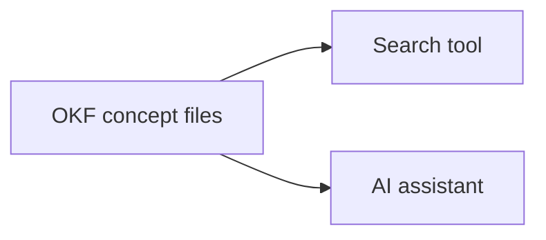
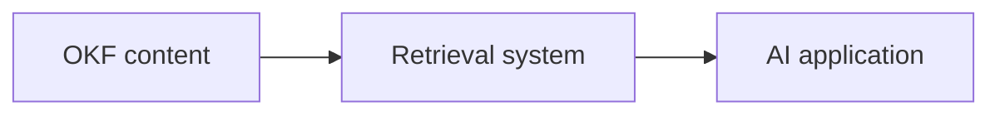

# Open Knowledge Format: A Developer’s Guide to Shareable AI Knowledge

## Explain what OKF is—and what it is not

The Open Knowledge Format (OKF) packages knowledge as a directory of Markdown concept files. Each file combines YAML front matter for structured metadata with a Markdown body for the concept’s content. The result is a bundle that people can read and tools can process. ([Source](https://cloud.google.com/blog/products/data-analytics/how-the-open-knowledge-format-can-improve-data-sharing))

That structure gives teams a portable way to share context across tools. Instead of rewriting the same explanation for a search application and an AI assistant, a team can maintain it in files that both systems can ingest. Portability does not guarantee that every tool will interpret or index the content identically.



**OKF is a content format, not the infrastructure around it.** It does not itself provide a database, search engine, embedding model, or retrieval-augmented generation (RAG) pipeline. Those systems can store, index, retrieve, and use OKF content; their implementation and operational choices remain separate. ([Source](https://www.domo.com/glossary/open-knowledge-format))



This diagram shows an **illustrative workflow**, not a pipeline required by OKF.

For the examples ahead, consider an internal payments API. A team might document concepts such as payment authorization, refunds, and error handling so developers and AI-assisted applications can draw on the same maintained context.

## Inspect the anatomy of a bundle

Start with a small example domain: a knowledge base about coffee. The following tree is **illustrative**, not a claim about an OKF-required layout:

```text
coffee-knowledge/
├── coffee-bean.md
├── espresso.md
└── grinder.md
```

Each file represents one concept. Keeping concepts separate makes them easier to review and update without editing a single large document. The filenames are descriptive choices; this example does not establish a required naming convention.

Here is the illustrative `espresso.md` file:

```markdown
---
title: Espresso
description: A concentrated coffee drink.
---

# Espresso

Espresso is prepared by forcing pressurized water through
finely ground coffee.
```

The lines between the `---` delimiters are **YAML front matter**: structured metadata in key-value form. Everything after the closing delimiter is the **Markdown body**, intended for readable explanation. Here, `title` and `description` demonstrate the distinction; they are not verified as required OKF fields.

Before calling a bundle conformant, check its fields, layout, and naming against the applicable specification. The [OKF site](https://okf.md) is a starting point, but the required fields and conventions could not be verified from the supplied material here. Treat this example as a reading aid, not a validated template.

The site also describes an `index.md` convention. Its applicability—including whether it is mandatory for a particular OKF bundle—could not be verified here. Consult the [OKF site](https://okf.md) before adding or relying on it as a requirement.

<svg xmlns="http://www.w3.org/2000/svg" viewBox="0 0 720 240" role="img" aria-label="A bundle directory contains three concept files. An arrow expands espresso.md into YAML front matter followed by a Markdown body.">
  <title>Bundle directory and concept-file anatomy</title>
  <rect x="10" y="10" width="280" height="220" rx="8" fill="#eef4ff" stroke="#315a9b"/>
  <text x="25" y="40" font-family="sans-serif" font-size="17" font-weight="bold">coffee-knowledge/</text>
  <text x="35" y="80" font-family="monospace" font-size="15">coffee-bean.md</text>
  <text x="35" y="115" font-family="monospace" font-size="15">espresso.md</text>
  <text x="35" y="150" font-family="monospace" font-size="15">grinder.md</text>
  <path d="M 180 110 L 335 110" stroke="#315a9b" stroke-width="2"/>
  <path d="M 325 104 L 335 110 L 325 116" fill="none" stroke="#315a9b" stroke-width="2"/>
  <rect x="350" y="10" width="360" height="220" rx="8" fill="#fff" stroke="#315a9b"/>
  <text x="365" y="40" font-family="sans-serif" font-size="17" font-weight="bold">espresso.md</text>
  <rect x="365" y="55" width="330" height="65" rx="4" fill="#e5f5e8"/>
  <text x="380" y="82" font-family="sans-serif" font-size="15">YAML front matter</text>
  <text x="380" y="105" font-family="monospace" font-size="13">title, description</text>
  <rect x="365" y="135" width="330" height="75" rx="4" fill="#fff2d9"/>
  <text x="380" y="162" font-family="sans-serif" font-size="15">Markdown body</text>
  <text x="380" y="185" font-family="monospace" font-size="13">heading and explanation</text>
</svg>

## Build a minimal knowledge bundle

Start with two Markdown files in a `bundle/` directory. Each owns one concept, making changes easy to review independently.

`bundle/authorization.md`:

```markdown
---
{}
---

# Payment authorization

An authorization checks whether funds are available and reserves them
for a later capture. It is not itself a refund.
```

`bundle/refunds.md`:

```markdown
---
{}
---

# Refunds

A refund returns some or all of a captured payment to the customer.
Refunds are separate from authorizations.
```

The empty YAML blocks give the local check something to parse; they are **not** a claim of OKF conformance. Before adding metadata or cross-references, check their field names, syntax, and requirements against the applicable OKF specification ([Source](https://okf.md)). Those details could not be verified here, so this example leaves them out.

### Check the front matter

Install PyYAML with `python -m pip install pyyaml`, then save this script as `check_bundle.py` and run `python check_bundle.py`:

```python
from pathlib import Path
import re
import sys

import yaml

failed = False

for path in sorted(Path("bundle").glob("*.md")):
    text = path.read_text(encoding="utf-8")
    match = re.match(
        r"\A---[ \t]*\r?\n(.*?)^---[ \t]*(?:\r?\n|$)",
        text,
        re.MULTILINE | re.DOTALL,
    )
    if not match:
        print(f"{path}: missing or unterminated front matter")
        failed = True
        continue

    try:
        yaml.safe_load(match.group(1))
        print(f"{path}: YAML parses")
    except yaml.YAMLError as error:
        print(f"{path}: malformed YAML: {error}")
        failed = True

sys.exit(1 if failed else 0)
```

Parsing only checks YAML syntax: it does not validate OKF fields, required content, or cross-references. Add a specification-aware validator before calling a bundle conformant. The script also does not check whether the directory contains the expected files.


*The local script checks front-matter syntax, not OKF conformance.*

<svg xmlns="http://www.w3.org/2000/svg" viewBox="0 0 720 100" role="img" aria-label="Workflow: authored bundle, then validation, then downstream indexing.">
  <title>Bundle workflow</title>
  <rect x="10" y="25" width="190" height="50" rx="6" fill="#dbeafe" stroke="#1e40af"/>
  <text x="105" y="55" text-anchor="middle" font-family="sans-serif" font-size="16">Authored bundle</text>
  <path d="M210 50h45m-8-6 8 6-8 6" fill="none" stroke="#333" stroke-width="2"/>
  <rect x="270" y="25" width="170" height="50" rx="6" fill="#dcfce7" stroke="#166534"/>
  <text x="355" y="55" text-anchor="middle" font-family="sans-serif" font-size="16">Validation</text>
  <path d="M450 50h45m-8-6 8 6-8 6" fill="none" stroke="#333" stroke-width="2"/>
  <rect x="510" y="25" width="200" height="50" rx="6" fill="#fef3c7" stroke="#92400e"/>
  <text x="610" y="55" text-anchor="middle" font-family="sans-serif" font-size="16">Downstream indexing</text>
</svg>

The indexing stage is an **illustrative retrieval workflow**, not a requirement established by this example: an application could index the validated files for search or retrieval.

## Connect the bundle to a retrieval workflow

An OKF bundle gives an application shareable knowledge content; it does not prescribe how the application finds or uses that content. For example, a reader could load concept files, extract their text, and pass it to an indexer. At query time, the application retrieves relevant excerpts and supplies them as context to an AI model ([Source](https://cloud.google.com/blog/products/data-analytics/how-the-open-knowledge-format-can-improve-data-sharing)).


Suppose one concept explains API-key authentication and another describes request rate limits. **Keyword retrieval** can match terms such as “API key” directly. **Semantic retrieval** can also find related wording, such as “authenticate a request,” even when the query and concept use different terms. These are application choices, not OKF requirements.


Test the workflow with: **“How do I authenticate an API request?”** In this illustrative result, the retrieved concept says, “Send the API key in the Authorization header.” That identifies the header, but not the exact header value. The application should retrieve more documentation or acknowledge the gap rather than guess. This is an example check, not a reported test result.

Budget for both indexing and queries. Larger documents can increase storage, embedding work, and the context sent to the model. Frequent updates can require repeated indexing; reindexing only changed content can reduce that work. Semantic search may also require embedding each query, while keyword search has its own index and lookup costs.

The distinction matters: OKF packages knowledge; a retrieval-augmented generation pipeline adds retrieval and generation around it ([Source](https://www.mindstudio.ai/blog/what-is-open-knowledge-format-okf-google-llm-wiki-standard)).

## Review, secure, and troubleshoot the bundle

Treat bundle maintenance as an ongoing review, not a one-time publishing step. Before each release, check for:

- **Stale facts:** Confirm dates, owners, and source material are still current.
- **Ambiguous concepts:** Clarify terms that have multiple meanings or overlapping definitions.
- **Broken cross-references:** Follow links and references to confirm their targets exist and still describe the intended concepts.

Test failure cases in a copy of the bundle: malformed front matter, a missing referenced file, duplicate concepts, and concepts that conflict. For each case, record whether your chosen tooling rejects the bundle, emits a warning, or continues without reporting an error. Capture the diagnostic and affected path so reviewers can reproduce the result.

<svg xmlns="http://www.w3.org/2000/svg" role="img" aria-label="A test bundle with an intentional error goes through a validation tool, producing a recorded result for review." viewBox="0 0 600 70">
  <title>Bundle failure-testing flow</title>
  <text x="10" y="40">Test bundle + error</text>
  <text x="190" y="40">→ Validation tool →</text>
  <text x="390" y="40">Recorded result</text>
</svg>

Keep secrets and sensitive personal data out of shared content. Restrict access to both the bundle and any downstream search or retrieval indexes; protecting only the source files leaves indexed copies exposed. Review access when sharing or retiring a bundle.

<svg xmlns="http://www.w3.org/2000/svg" role="img" aria-label="Access controls protect both a shared bundle and the downstream index built from it." viewBox="0 0 600 70">
  <title>Protect the bundle and its index</title>
  <text x="10" y="40">Controlled bundle</text>
  <text x="210" y="40">→</text>
  <text x="270" y="40">Controlled downstream index</text>
</svg>

During ingestion, log file paths and validation errors, but not document contents. Restrict log access too: paths and diagnostics can themselves reveal sensitive information. These are operational practices for an illustrative ingestion workflow, not additional OKF requirements.

As a next step, version the sample bundle and add your chosen validation check to continuous integration. Review failures before merging changes, and retain the test cases as the bundle evolves.